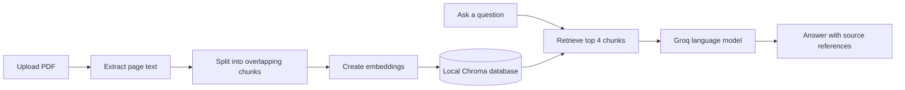

<div align="center">

# PaperPilot

### Chat with your PDFs. Find the answers that matter.

An interactive PDF question-answering app built with Streamlit and retrieval-augmented generation (RAG). Upload documents, ask questions in plain language, and get answers grounded in relevant passages.

<br>


</div>

---

## At a glance

PaperPilot turns a collection of PDFs into a searchable, conversational knowledge base. It extracts document text, creates vector embeddings, retrieves relevant chunks for each question, and passes those chunks to a Groq-hosted language model as context.

**Built for:** exploring notes, reports, handbooks, and other text-based PDF documents.

## What it does

- **Add PDF documents** using the app’s sidebar uploader.
- **Build a local knowledge base** with sentence-transformer embeddings and Chroma.
- **Ask questions in a chat interface** and keep the conversation visible during your app session.
- **See source references** with document names and page numbers when available.
- **Get context-aware responses** instructed to say when the answer is not in the supplied document context.
- **Use a custom dark interface** with lightweight animations.

## How it works



Uploaded files are briefly written to a temporary PDF so the document loader can read them. The temporary file is removed after extraction. The vector database is stored locally in `embedding/VectorDB`.

## Technology

| Area | Project components |
| --- | --- |
| Interface | Streamlit |
| PDF processing | LangChain Community `PyPDFLoader`, pypdf |
| Chunking | LangChain `RecursiveCharacterTextSplitter` |
| Embeddings | Hugging Face `sentence-transformers/all-MiniLM-L6-v2` |
| Vector search | Chroma |
| Chat model | Groq through LangChain; the app currently selects `openai/gpt-oss-120b` |

The current text splitter uses **500-character chunks** with **100 characters of overlap**. Each question retrieves up to **4 relevant chunks** for model context.

## Get started

### 1. Prerequisites

- Python **3.13 or newer**
- A [Groq API key](https://console.groq.com/keys)
- [uv](https://docs.astral.sh/uv/) (recommended)

### 2. Clone and install

```powershell
git clone https://github.com/rohitlonkar2006/RAG-Based-PDF-ChatBot.git
cd RAG-Based-PDF-ChatBot
uv sync
```

### 3. Configure your API key

Create a `.env` file in the project root:

```env
GROQ_API_KEY=your_groq_api_key
```

Keep this key private. `.env` is local configuration and should not be committed or shared.

### 4. Launch PaperPilot

```powershell
uv run streamlit run main.py
```

Open the local URL printed in your terminal.

## Use the app

1. Select **Choose PDF files** in the sidebar and add one or more PDFs.
2. Select **Add to knowledge base** and wait for indexing to finish.
3. Enter a question in the chat box.
4. Review the answer and its source references.

## Project structure

```text
.
├── agent/
│   └── llm_pick.py       # Groq chat-model selection
├── data/                 # Example PDF
├── embedding/
│   └── embed.py          # PDF loading, chunking, embeddings, and Chroma
├── main.py               # Streamlit application and chat UI
├── pyproject.toml        # Dependencies and project configuration
├── requirements.txt      # Dependency list
└── .env                  # Your local Groq API key (create this)
```

## Notes

- The Chroma database persists on disk between app runs. Uploaded document chunks are added to that local database.
- Chat history and the active vector-store connection are held in Streamlit session state.
- The embedding model is downloaded when it is first needed, so initial indexing may take longer and may require an internet connection.
- Scanned PDFs that do not contain extractable text may need OCR before their contents can be searched.

## Troubleshooting

| Issue | What to check |
| --- | --- |
| `GROQ_API_KEY` is missing | Make sure `.env` is in the project root and contains `GROQ_API_KEY=...`; restart the app after editing it. |
| Uploaded object is reported as an invalid file path | Stop the Streamlit process and restart it from this repository with `uv run streamlit run main.py` so the current upload-handling code is loaded. |
| First indexing is slow or the embedding model fails to load | Check your internet connection; the Hugging Face embedding model is downloaded on first use. |
| An answer cannot be found in a document | Confirm the PDF contains extractable text and try asking about a specific topic or phrase. |

---

<div align="center">

**PaperPilot** · Ask better questions of the documents you already have.

</div>
